# Mini Paragon

A tiny ground-control demo: a C++ aircraft sim streams telemetry to a CesiumJS 3D globe in your browser.

The following finite state machine gives a broad overview of the system:

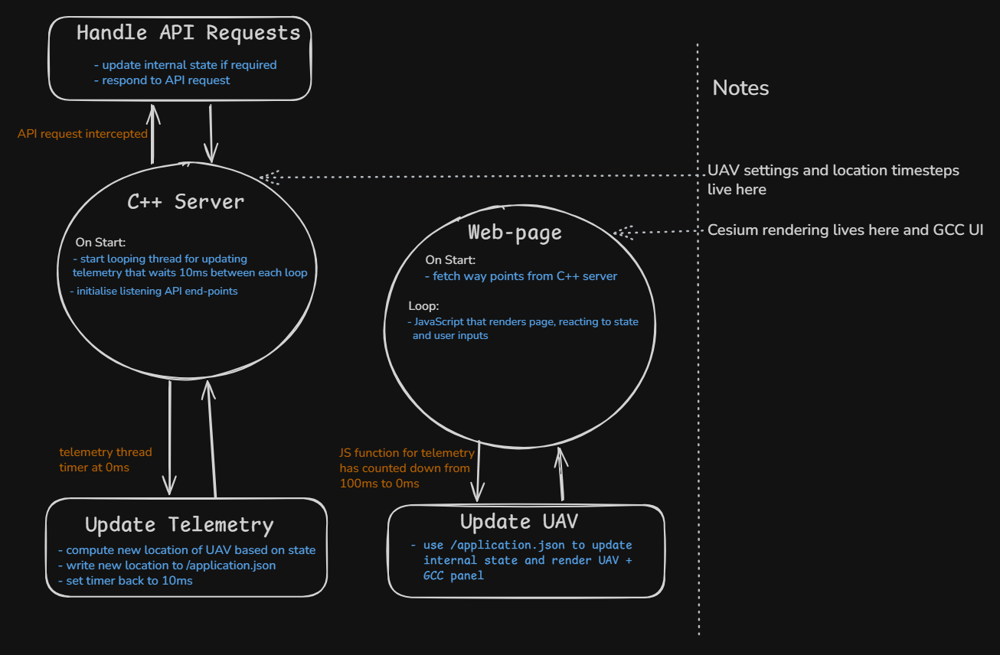<br>
      <b>Summarised FSM of system.</b><br>

## Autopilot Mission

When UAV in autopilot mode, it will navigate to way points in a loop from a starting spawn point.

#### C++ Server starts with UAV at S-Plane Automation in Sommerset West, Cape Town

The UAV model on the C++ server is initialsed with the following fields:
```
double lat = -34.15;        
double lon = 18.85; 
```

<table>
  <tr>
    <td align="center">
      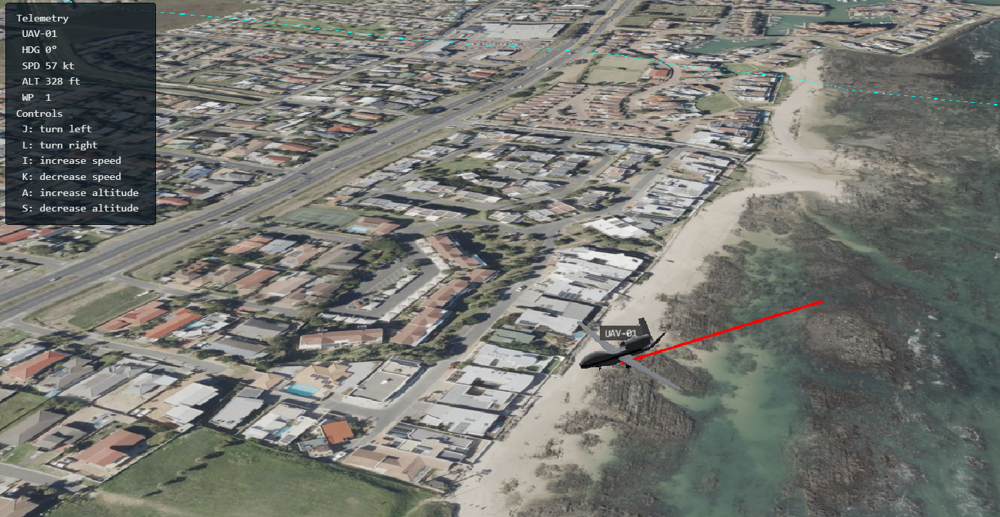<br>
      <b>Spawn 3D View</b><br>
      UAV spawns near S-Plane in Cape Town
    </td>
    <td align="center">
      <br>
      <b>Spawn Point on Map</b><br>
      Spawn point location on 2D map
    </td>
  </tr>
</table>

#### Wap Points

C++ server has preprogrammed set of way points and global variable for next target way point:
```
std::vector<Waypoint> route = {
    {-34.15, 18.85},
    {-34.10, 18.95},
    {-34.18, 19.00},
    {-34.22, 18.88},
};
int nextWp = 1; 
```


<!-- <div align='center'>

Starting point of UAV in 3D environment
</div>

<div align='center'>
 -->
<table>
  <tr>
    <td align="center">
      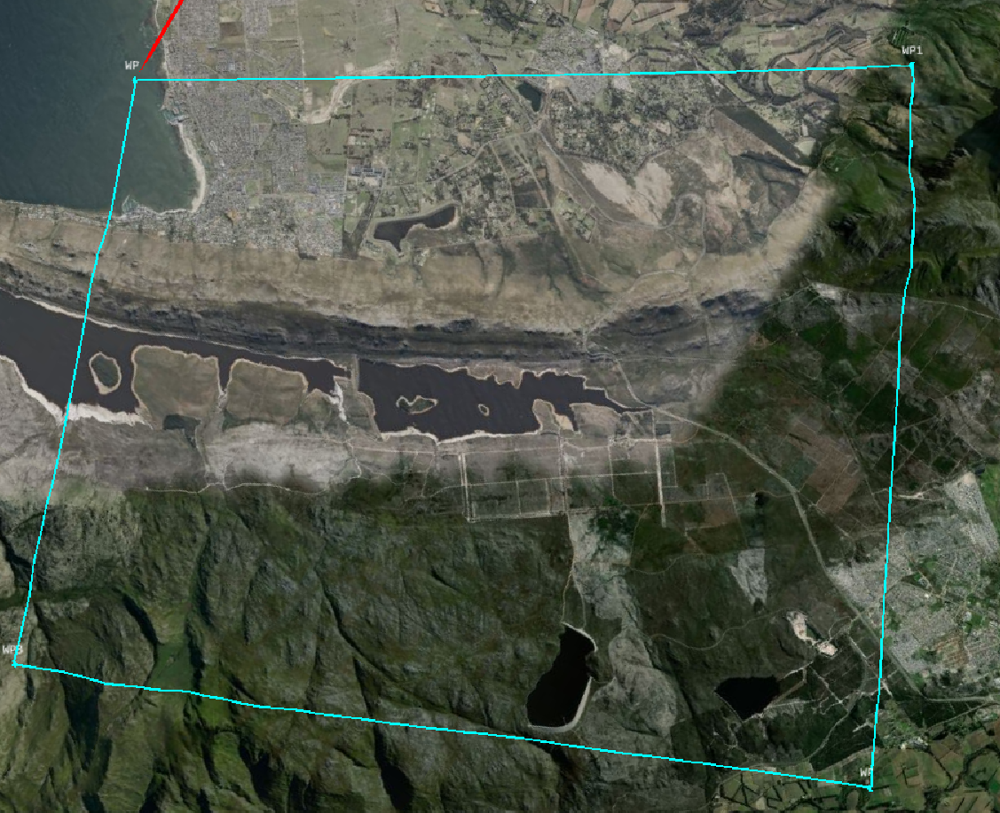<br>
      <b>Wap points aerial view</b><br>
    </td>
    <td align="center">
      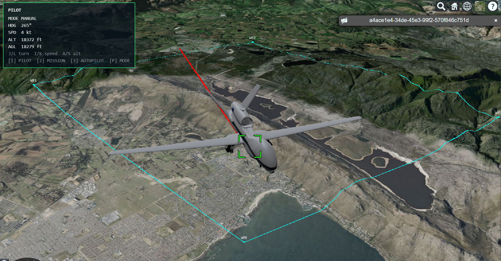<br>
      <b>mission mapped onto earth surface</b><br>
    </td>
  </tr>
</table>


## GCC 

### Primary Modes

The GCC (Ground Countrol Centre) has three primary modes.

<table>
  <tr>
    <td align="center">
      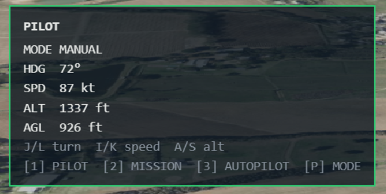<br>
      <b>Pilot Mode</b><br>
      Shows whether UAV in manual or pilot mode, as well as telemetry.
    </td>
    <td align="center">
      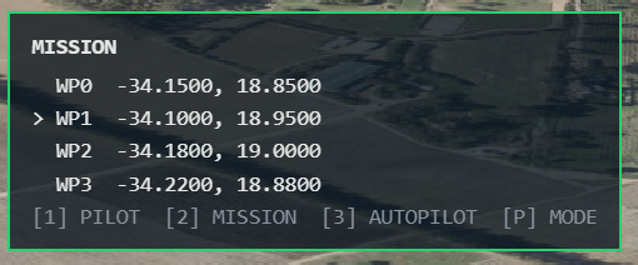<br>
      <b>Mission Mode</b><br>
      Shows list of way-points, and currently pursued way-point.
    </td>
        <td align="center">
      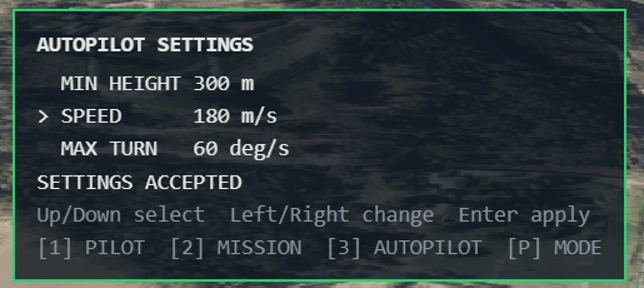<br>
      <b>Autopilot Mode</b><br>
      Provides a way to change autopilot settings.
    </td>
  </tr>
</table>

Changing to autopilot can be done from any mode, with UI contructs to prevent mistakes:

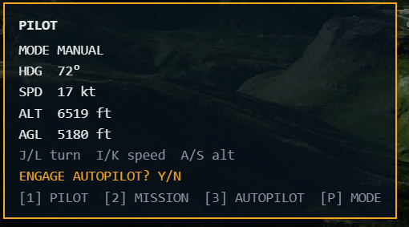<br>
      <b>Change to autopilot</b><br>
      Warning message and yellow colour form part of UI design heuristics for state awareness and error reduction.

### State Awarness

Based on the AGL field (above ground level) from the telemetry, the UI uses three colours to ensure state awareness:

<table>
  <tr>
    <td align="center">
      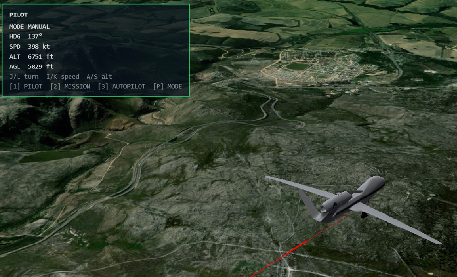<br>
      <b>Healthy AGL state (green)</b><br>
      <!-- Turn direction indicator -->
    </td>
    <td align="center">
      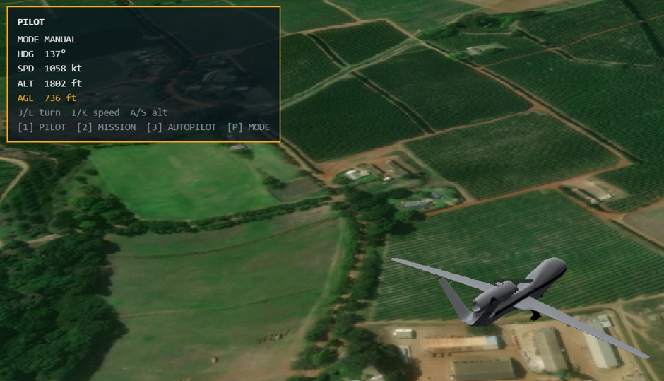<br>
      <b>Moderate AGL state (amber)</b><br>
      <!-- Alternative turn indicator -->
    </td>
        <td align="center">
      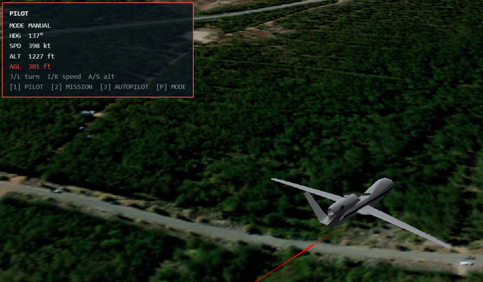<br>
      <b>Dangerous AGL state (red)</b><br>
      <!-- Alternative turn indicator -->
    </td>
  </tr>
</table>

### More Error Prevention

A common design heuristic is too prevent invalid user input altogether. In this case, manual control cannot be done while in autopilot mode, and if autopilot settings fall out of a threshold, they are rejected by the UAV:

<table>
  <tr>
    <td align="center">
      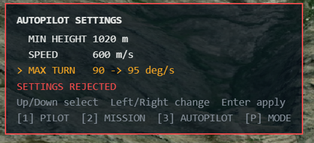<br>
      <b>Autopilot settings update rejected (red with failure notification)</b><br>
      <!-- Turn direction indicator -->
    </td>
    <td align="center">
      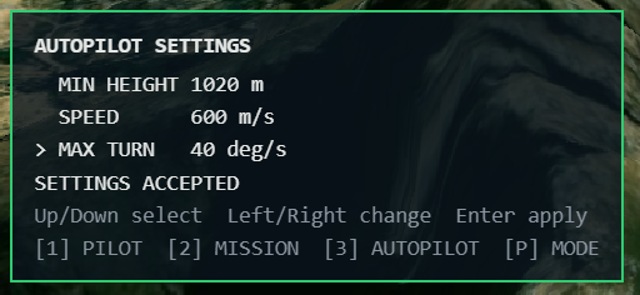<br>
      <b>Autopilot settings update accepted (green with success notification)</b><br>
      <!-- Alternative turn indicator -->
    </td>
  </tr>
</table>


## Manual Mode
#### Manul Mode Controls
##### Turn Directions

There is much to be desired in terms of aerial mechanics and reactivity from the UI here, but the following are the controls usable when not in autopilot:

<table>
  <tr>
    <td align="center">
      <br>
      <b>Turn right (L)</b><br>
      <!-- Turn direction indicator -->
    </td>
    <td align="center">
      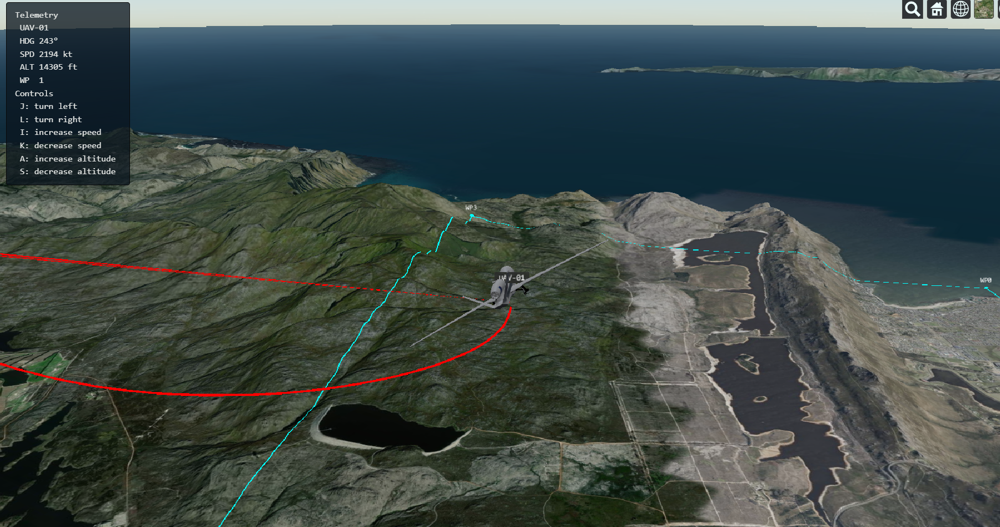<br>
      <b>Turn left (J)</b><br>
      <!-- Alternative turn indicator -->
    </td>
    <td align="center">
      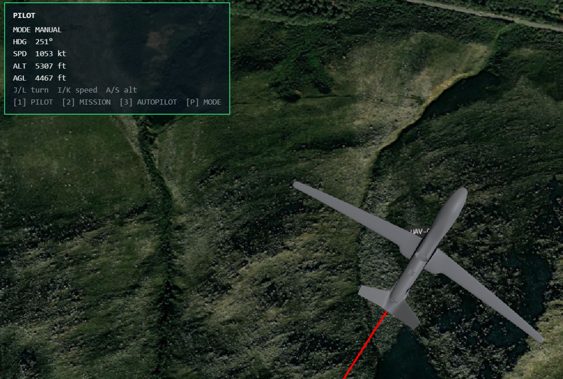<br>
      <b>Increase speed (I)</b><br>
      <!-- Alternative turn indicator -->
    </td>
  </tr>
</table>

##### Vertical Directions

<table>
  <tr>
    <td align="center">
      <br>
      <b>Turn Up (A)</b><br>
      <!-- Upward direction indicator -->
    </td>
    <td align="center">
      <br>
      <b>Turn Down (S)</b><br>
      <!-- Downward direction indicator -->
    </td>
    <td align="center">
      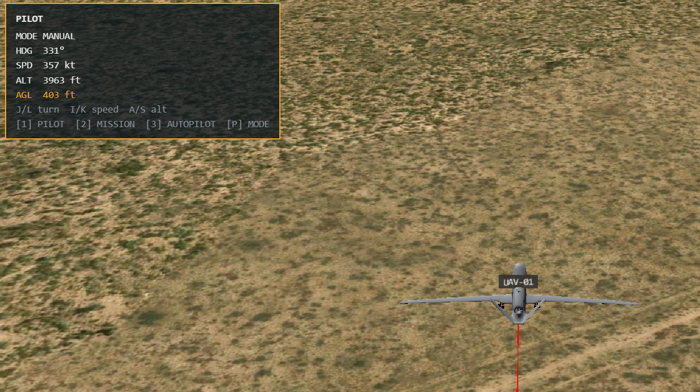<br>
      <b>Decrease Speed (K)</b><br>
      <!-- Alternative turn indicator -->
    </td>
  </tr>
</table>


## Setup

1. Download httplib.h from <a href="https://github.com/yhirose/cpp-httplib">cpp-httplib</a>. This is a C++11 single-file header-only cross platform HTTP/HTTPS library.
2. Download 'Global Hawk' model from <a href ='https://science.nasa.gov/3d-resources/global-hawk/'>Global Hawk</a> as jet.glb to /web.

## Run

1. Build server (Windows)
```powershell
g++ -std=c++17 server.cpp -o server.exe -pthread -lws2_32
```
2. Add Cesium Token (free plan token after sign up) to field in index.html
   ```
   const CESIUM_TOKEN = "<YOUR TOKEN>";
   ```
3. Run server (Windows)
```powershell
./server
```
4. Open http://localhost8080 on a browser


