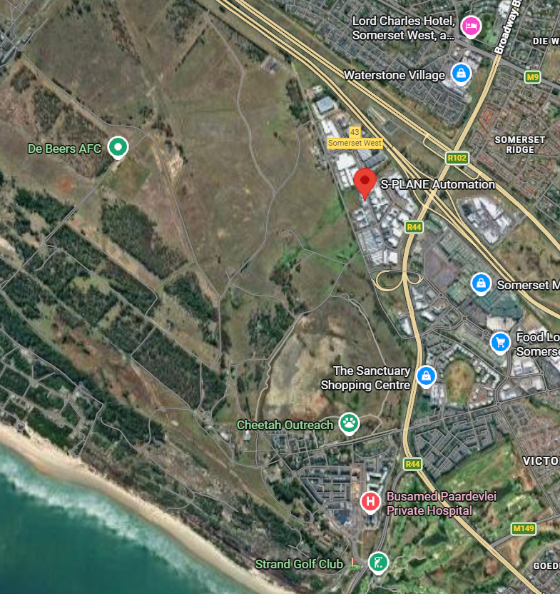
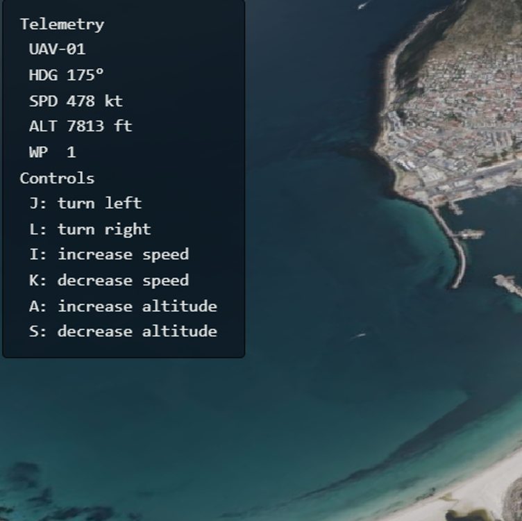
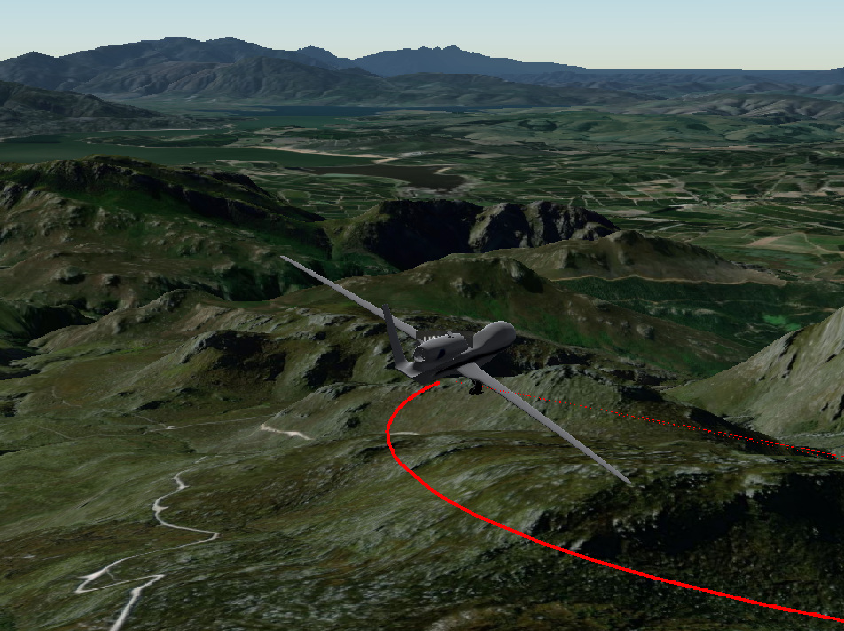
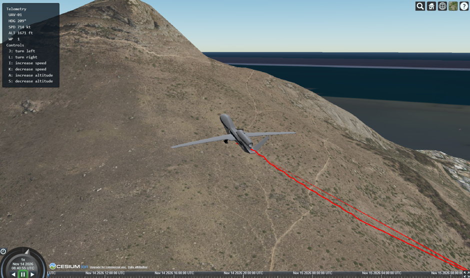
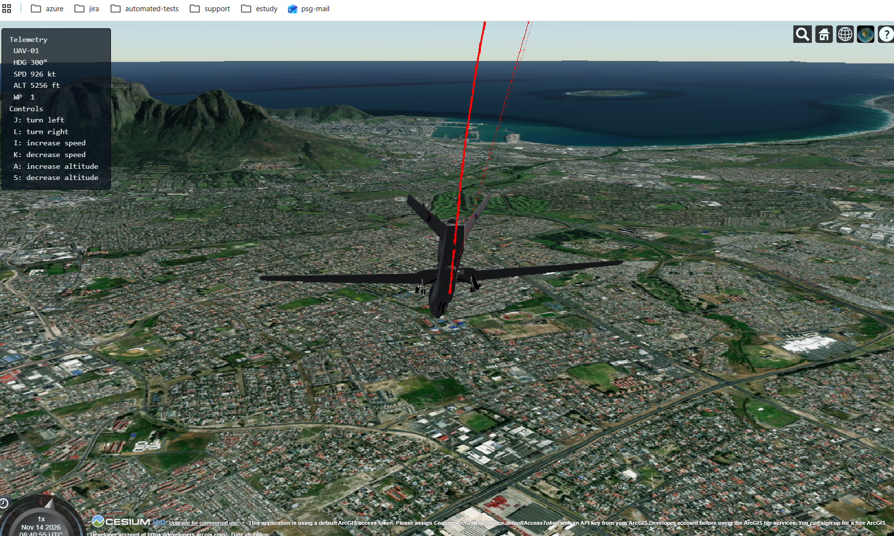

# Mini Paragon

A tiny ground-control demo: a C++ aircraft sim streams telemetry to a CesiumJS 3D globe in your browser.

### C++ Server starts with UAV at S-Plane Automation in Sommerset West, Cape Town

The UAV model on the C++ server is initialsed with the following fields:
```
double lat = -34.15;        
double lon = 18.85; 
```

<!-- <div align='center'>

Starting point of UAV in 3D environment
</div>

<div align='center'>
 -->
<table>
  <tr>
    <td align="center">
      <br>
      <b>Spawn 3D View</b><br>
      UAV spawns near S-Plane in Cape Town
    </td>
    <td align="center">
      <br>
      <b>Spawn Point on Map</b><br>
      Spawn point location on 2D map
    </td>
  </tr>
</table>


### HUD Provides Telemetry and Controls Information

<div align='center'>


HUD
</div>

### Controls
## Turn Directions

<table>
  <tr>
    <td align="center">
      <br>
      <b>Turn right</b><br>
      <!-- Turn direction indicator -->
    </td>
    <td align="center">
      <br>
      <b>Turn left</b><br>
      <!-- Alternative turn indicator -->
    </td>
  </tr>
</table>

## Vertical Directions

<table>
  <tr>
    <td align="center">
      <br>
      <b>Turn Up</b><br>
      <!-- Upward direction indicator -->
    </td>
    <td align="center">
      <br>
      <b>Turn Down</b><br>
      <!-- Downward direction indicator -->
    </td>
  </tr>
</table>


## Setup

1. Download httplib.h from <a href="https://github.com/yhirose/cpp-httplib">cpp-httplib</a>. This is a C++11 single-file header-only cross platform HTTP/HTTPS library.
2. Download 'Global Hawk' model from <a href ='https://science.nasa.gov/3d-resources/global-hawk/'>Global Hawk</a> as jet.glb to /web.

## Run

1. Build server (Windows)
```powershell
g++ -std=c++17 server.cpp -o server.exe -pthread -lws2_32
```
2. Run server (Windows)
```powershell
./server
```
3. Open http://localhost8080 on a browser


